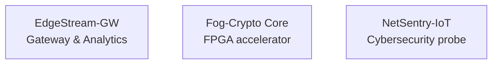
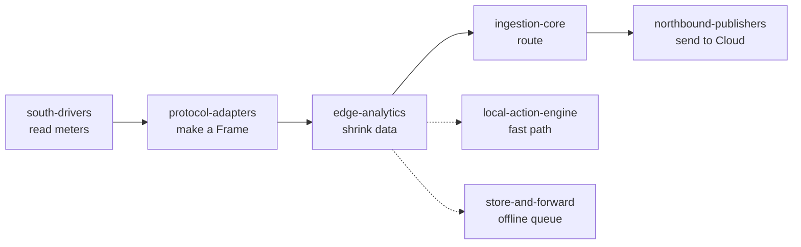
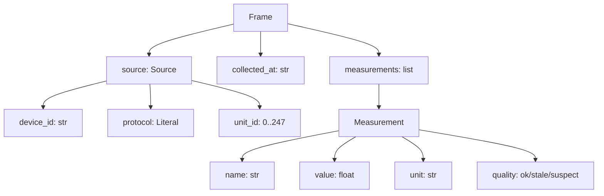
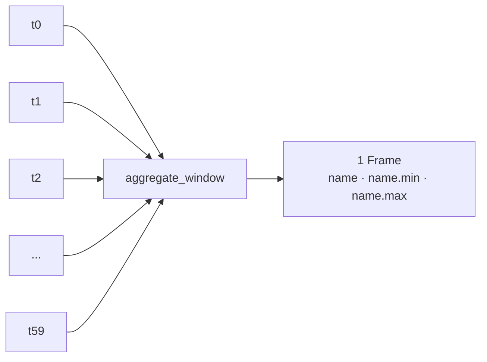
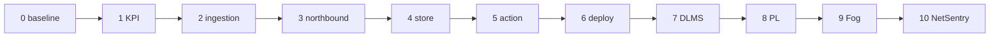

# Tutorial: Build EdgeStream-GW up to Milestone 1 — the beginner's edition

*Written for someone who is new to industrial protocols, new to CMMI, and still
getting comfortable with code. We explain every idea in plain words first, then
show just enough code. You do not need to be a Modbus or CMMI expert to follow
this — by the end, you will understand what was built and why.*

> **Part 1 of a series.** This tutorial covers **Milestone 0** (the baseline: protocol
> adapters, Edge Analytics PS, the 50-meter test bench) and **Milestone 1** (the proof
> of the −75 % data-reduction KPI). Each later milestone gets its own tutorial in the
> same series. The full roadmap is in §16.

---

## 1. Welcome — what we're building

EdgeStream-GW is a small piece of software that sits **between** physical devices
(electricity meters) and the Cloud. Its two jobs:

1. **Read** measurements from many meters.
2. **Shrink** that data before sending it to the Cloud, so we send far less
   (the target: at least **75 % less**), while keeping the important information.

By "Milestone 1" we have built and *proven* the shrinking part. Everything else
(sending to the Cloud, offline storage, the fast reaction loop) comes later.

This gateway is one of three portfolio projects that share the same way of working:



If the jargon is new to you, keep a finger on section 3 (the glossary) and come
back to it whenever a word feels slippery.

---

## 2. The tools you'll need

| Tool | What it does (in plain words) |
| --- | --- |
| **Python** | The programming language. Easy to read, good for this kind of work. |
| **venv** | A private "box" of installed tools for *this project only*, so we don't mess up your system. |
| **pytest** | Runs our tests and tells us which ones pass or fail. |
| **pydantic** | A library that checks the *shape* of our data (more in section 7). |
| **hypothesis** | A library that throws *random* inputs at our code to find hidden bugs. |
| **pytest-cov** | Counts how many lines of code our tests actually exercise. |
| **git** | Remembers every version of our work, so we can move back in time safely. |

You don't need to install anything special to *read* this tutorial. When you want
to *run* things, the commands are at the bottom (section 15).

---

## 3. Plain-language glossary

These are the words you'll meet over and over:

- **Program** — a file (or files) of instructions the computer follows.
- **Function** — a small, named block of instructions that does *one* job. You call it by name.
- **Class** — a blueprint for making objects that bundle data + behaviour together.
- **Object** — one concrete thing built from a class (e.g. one `Frame`, one `Meter`).
- **Type** — the *kind* of a value: is it a whole number (`int`), a decimal (`float`), text (`str`), or True/False (`bool`)?
- **Exception** — the computer's way of saying "something went wrong; stop and tell me." Our code uses exceptions on purpose (section 8).
- **Library** — code written by someone else that we reuse instead of reinventing.
- **Test** — a small program that checks our real code behaves correctly.
- **Test-first (TDD)** — write the test *before* the code; watch it fail; then write code until it passes.
- **Schema / contract** — an agreed *shape* for data: which fields must exist, what type each one is, what values are allowed.
- **Fail-Fast** — the rule "if data is bad, refuse it loudly now, never quietly fix it."
- **Deterministic** — the same input always gives the same output. (Very useful for tests and measurements.)
- **Byte** — the smallest unit of data on a wire or disk. Raw messages are just a bunch of bytes.
- **Protocol** — an agreed "language" two machines use to talk to each other.
- **Register** — one numbered box inside a Modbus device holding one number (section 4).
- **Frame** — our one clean "envelope" that all data gets put into (section 7).
- **Aggregate** — to combine many values into one summary value.
- **Reducer** — the *rule* used to combine values (e.g. "keep the average" or "keep the biggest").
- **KPI** — Key Performance Indicator: a number that proves we hit our goal (here: −75 %).
- **Milestone** — a checkpoint: a chunk of work, done and verified, that we can point to.
- **Commit / tag** — git's way of saving a snapshot, and giving a snapshot a name.

---

## 4. What is Modbus? (in plain words)

Modbus is a very old, very simple way for a computer to ask an industrial device
— like an electricity meter — *"what are your readings?"* and get an answer back.

Think of a meter as a **wall of little numbered boxes**. Each box is called a
**register**, and each one holds one number:

```
box 1  = voltage_l1        (e.g. 230.5 V)
box 2  = current_l1        (e.g. 12.34 A)
box 3  = active_power      (e.g. 2845 W)
box 4  = active_energy     (e.g. 312.6 kWh)
```

To read the boxes, the computer sends a short message that means:
**"Device number 1, please read boxes 1 through 4 for me."**
That "read the boxes" request is called **function code 03**. The device replies
with the numbers inside those boxes.

That's 80 % of Modbus for our purposes. The other 20 % is *how the message travels*:

- **Modbus RTU** — travels over a **cable** (serial). Because cables can be noisy,
  the message ends with a small check number called a **CRC**. The receiver
  recomputes it; if it doesn't match, the message got scrambled and must be thrown away.
- **Modbus TCP** — travels over a **network** (like ethernet). The same question
  and answer, but wrapped in an extra envelope called an **MBAP header** (which
  carries a transaction number and a length).

> **Our job is not to become a Modbus expert.** Our job is to take the raw bytes
> that come off the wire and turn them into one clean, *checked* object — the Frame.

---

## 5. What is CMMI? (in plain words)

Don't let the acronym scare you. CMMI is just a company saying:

> *"We agree to work in a documented, repeatable way, so our results don't depend
> on who happens to be typing that day."*

For this project it boils down to **three habits**:

1. **Think first.** Write down what you want (the *requirements*) and how you'll
   build it (the *design*) *before* you code.
2. **Test first (TDD).** For every piece, write the test, watch it fail, then
   write the smallest code that makes it pass, then tidy up.
3. **Reuse sensibly.** Use existing tools when they're good enough (like a Modbus
   library). Build it yourself *only* when you need strict control — like our
   fail-loud parser, which must refuse bad data instead of quietly "fixing" it.

That's it. You do **not** need to memorize a CMMI rulebook. Just remember:
**think first, test first, reuse sensibly.** The whole repo is organized around
those three habits, which is why it has folders called `requirements/`,
`design/`, `testbench/`, and `src/`.

---

## 6. The big picture: the data pipeline

Data flows through the gateway like water through a pipe, from **south** (the
meters) to **north** (the Cloud):

```
south-drivers  →  protocol-adapters  →  edge-analytics  →  ingestion-core  →  northbound-publishers
  (read meters)     (make a Frame)       (shrink data)      (route data)        (send to Cloud)
```



Up to Milestone 1, we build only two blocks plus their helpers:

- **protocol-adapters** — turn raw bytes into a clean `Frame`.
- **edge-analytics** — shrink many `Frame`s into fewer ones (the −75 %).
- **the test bench** — a fake fleet of 50 meters, so we can test without real hardware.

The blocks we *don't* build yet (south-drivers, ingestion-core, northbound-publishers)
come in later milestones. Knowing they exist is enough for now.

---

## 7. The Frame: one shared envelope

The single most important idea in the whole project:

> **Everyone agrees on one shape for data, called `Frame`. Once data is inside a
> Frame, nobody cares whether it came from Modbus RTU, Modbus TCP, or DLMS.**

A Frame carries:

- **who** the data came from (`source`: device id, protocol, unit id),
- **when** it was collected (`collected_at`),
- **what** was measured (`measurements`: a list of name + value + unit + quality).

In Python, we *describe* that shape with `pydantic`, and we are **strict** about it:

```python
class Source(BaseModel):
    model_config = ConfigDict(extra="forbid")   # reject anything unexpected
    device_id: str
    protocol: Literal["modbus_rtu", "modbus_tcp", "dlms_cosem"]
    unit_id: int = Field(ge=0, le=247)          # must be between 0 and 247

class Frame(BaseModel):
    model_config = ConfigDict(extra="forbid")
    frame_id: UUID
    source: Source
    collected_at: str
    measurements: list[Measurement] = Field(min_length=1)  # never empty
```



**Why be strict? (quality habit)** If someone accidentally sends an extra field,
or forgets a field, or uses a value out of range, we want a **loud error**, not a
silent "we'll ignore it." A silent ignore means a typo can produce data that
*looks* fine but is actually wrong.

> Beginner translation: `model_config = ConfigDict(extra="forbid")` means
> "if you hand me a field I don't know about, I refuse." `Field(ge=0, le=247)`
> means "this number must be between 0 and 247."

---

## 8. Part 1 — Protocol adapters: bytes → Frame

### 8.1 The "fail loudly" rule (Fail-Fast)

When we read raw bytes from a wire, sometimes they're **corrupted** — cut off,
scrambled by noise, or not what we expected. Our rule:

> **Never silently fix bad data. Refuse it, loudly, immediately.**

We refuse by *throwing* a special error called `CorruptedPayloadError`. It carries
a **reason code** — a short label that says *why* the data was bad:

```
TRUNCATED         the message was cut short
BAD_CRC           the check number doesn't match (RTU)
WRONG_FC          it's not a "read the boxes" (03) message
INCOMPLETE_ARRAY  the number of boxes doesn't match what we expect
OUT_OF_RANGE      a value is outside its allowed limits
BAD_UNIT_ID       the device number is wrong or out of range
WRONG_PROTOCOL    we were told RTU but got TCP, etc.
```

Downstream code can check `exc.reason_code` and react — no messy string-matching.

### 8.2 The input and the interface

Before parsing, the raw message arrives as a `RawPayload` — a simple, **frozen**
(unchanging) bundle:

```python
@dataclass(frozen=True)
class RawPayload:
    protocol: str        # "modbus_rtu" | "modbus_tcp" | "dlms_cosem"
    device_id: str
    unit_id: int
    collected_at: str    # the timestamp, filled in by the driver (not us)
    data: bytes          # the raw message, exactly as received
```

Then every adapter implements the **same** promise:

```python
class ProtocolAdapter(ABC):
    def parse(self, payload: RawPayload) -> Frame:
        """Return a valid Frame, or raise CorruptedPayloadError. Nothing else."""
```

**Why this matters:**

- Because `parse` always returns `Frame` (or fails), every later block can trust
  that "a Frame is always a *valid* Frame."
- Because the timestamp is *handed to us* (`collected_at`) and never read from the
  clock inside the adapter, the adapter is **pure**: same input → same output.
  That makes it easy to test and easy to replay.
- Because it's an interface (the ABC), we can later add a DLMS adapter behind the
  *same* promise without changing anything downstream.

### 8.3 Modbus RTU, in broad strokes

The RTU adapter does these checks, in order, and **stops at the first failure**:

1. Is the protocol really `modbus_rtu`? → else `WRONG_PROTOCOL`.
2. Is the device number (`unit_id`) in range? → else `BAD_UNIT_ID`.
3. Is the message long enough to even be a real message? → else `TRUNCATED`.
4. Does the device number inside the message match what we expected? → else `BAD_UNIT_ID`.
5. Does the length add up? → else `TRUNCATED`.
6. Does the CRC check number match? → else `BAD_CRC`.
7. Is it a "read the boxes" (function code 03) message? → else `WRONG_FC`.
8. Are there the right number of boxes, and is every value in range? → else
   `INCOMPLETE_ARRAY` / `OUT_OF_RANGE`.

Only if **all** of that passes do we build a `Frame`.

You don't need to write the CRC math yourself — but here's the idea: the sender
runs a small calculation over the message and appends the result. The receiver
runs the same calculation and compares. If they differ, the message was damaged.
The code does exactly that:

```python
def crc16(data: bytes) -> int:
    crc = 0xFFFF
    for byte in data:
        crc ^= byte
        for _ in range(8):
            crc = (crc >> 1) ^ (0xA001 if crc & 1 else 0)
    return crc
```

> **Reading tip:** don't try to understand every operator in `crc16`. The point is
> "it computes a check number." What matters for you is *when* we call it and *why*
> we refuse if it doesn't match.

### 8.4 Modbus TCP: same idea, different envelope

TCP does the same checks, but the message is wrapped in an MBAP header. So before
the "read the boxes" part, we check:

- the `protocol_id` is `0` (it always is, for Modbus) → else `WRONG_PROTOCOL`,
- the declared `length` matches reality → else `TRUNCATED`,
- the total number of bytes is exactly what we expect → else `TRUNCATED`.

The *decoding* of the boxes themselves is shared — it lives in one place
(`decode_holding_registers`) so RTU and TCP don't duplicate it.

### 8.5 Letting a computer throw random junk at your code

Hand-written tests can't prove "nothing unexpected ever escapes." So we use
`hypothesis` to generate **hundreds of random byte strings** and feed them to
`parse`. The promise we check is:

> For *any* random bytes, `parse` either returns a valid `Frame` **or** raises
> `CorruptedPayloadError` — never any other error, never a crash.

```python
@given(st.binary(max_size=64))
def test_rtu_arbitrary_bytes_never_crash(data: bytes):
    try:
        frame = RTU.parse(RawPayload(..., data=data))
    except CorruptedPayloadError:
        return                      # expected: bad input fails fast
    assert isinstance(frame, Frame) # or we got a valid frame
```

If our code ever leaked an `IndexError` or a crash on weird input, this test
would catch it. That's the "exception isolation" rule, enforced by a machine
instead of by hoping.

---

## 9. Part 2 — Edge Analytics: shrinking the data (the −75 %)

### 9.1 What "aggregation" means

Imagine one meter reports every second. Over a minute, that's **60 frames**.
Do we need to send all 60 to the Cloud? Usually not — the Cloud mostly needs a
**summary** of that minute.

So we take those 60 frames and squash them into **1 frame** that says, for each
measured quantity:

- the **representative value** (by default, the RMS — a kind of average that's
  meaningful for electrical signals),
- the **minimum**,
- the **maximum**.

```
60 frames  →  1 frame with  { voltage_l1, voltage_l1.min, voltage_l1.max,
                              current_l1, current_l1.min, current_l1.max, ... }
```



That's the whole −75 % trick: **many frames in, one frame out.**

### 9.2 The three small pieces

The code is split into three tiny, single-job pieces:

- **`compute_stats(frames)`** — for each quantity name, compute mean, rms, min,
  max, last, count.
- **`aggregate_window(frames)`** — take a batch of frames (all from the same
  device, same time window) and produce **one** frame with `name`, `name.min`,
  `name.max` for each quantity. It *refuses* an empty batch, a bad reducer, or a
  batch mixing two different devices.
- **`WindowAggregator`** — a helper that keeps a little buffer and, every time a
  time window (say 60 seconds) is crossed, flushes one aggregated frame.

There's also **`dedupe`**, which drops *consecutive* identical frames (if two
readings in a row are exactly the same, the second adds nothing).

> **Quality habit — single responsibility:** each function does one clear thing.
> That's why each one is short, easy to test, and easy to reason about.

### 9.3 Why this is a good design

Notice what we did **not** do: we did *not* change the `Frame` shape to carry
stats. Instead, we express "min" and "max" as *additional measurements named*
`voltage_l1.min` and `voltage_l1.max`. That keeps the one shared envelope
(section 7) stable — nothing downstream needs to change. This is recorded as
"Decision 10" in the design log.

---

## 10. Part 3 — the fake 50-meter fleet (the test bench)

We don't want to buy 50 real meters just to test. So we **simulate** them in code.

The simulator has two key properties:

1. **It behaves like real meters** — each meter holds a voltage, a current, etc.,
   and drifts a little each second (voltage wobbles by a small random amount,
   energy slowly accumulates).
2. **It is deterministic** — every meter is given a *seed* (a starting number for
   its randomness). The same seed always produces the same readings.

```python
class EnergyMeter:
    def __init__(self, device_id, unit_id, seed=None):
        self._rng = random.Random(seed)   # the seed makes it repeatable

class MeterFleet:
    def __init__(self, count=50, seed=0):
        self.meters = [EnergyMeter(f"meter-{i:03d}", i + 1, seed=seed + i)
                       for i in range(count)]
```

**Why determinism is a superpower:** if a test fails, it fails the *same way every
time* — you can reproduce it, fix it, and be confident. And when we measure the
−75 % KPI, we can re-run the exact same scenario and get the same numbers.

The test bench also has **frame builders** — helpers that wrap a meter's numbers
into a realistic raw Modbus message (RTU or TCP), reusing the same CRC function
the adapter uses. Then an end-to-end test proves the whole chain works:

```
simulator → (raw bytes) → adapter → (valid Frame) → ...for all 50 meters
```

---

## 11. Proving it: measuring the −75 % (Milestone 1)

Having the code is not enough — we must **measure** that it actually hits the KPI.

The measurement (`performance/measure_volume_reduction.py`) does this:

1. Simulate **50 meters × 300 seconds at 1 reading/second** → **15 000 raw frames**.
2. Parse each into a `Frame`.
3. Feed each into a per-meter `WindowAggregator` with a **60-second window**.
4. Count the **JSON bytes** of the raw frames vs the aggregated frames.

The result, run 5 times with different seeds (to be sure it's stable):

| Metric | Raw | Aggregated | Reduction |
| --- | --- | --- | --- |
| Frames | 15 000 | 250 | **98.33 %** |
| Measurements | 60 000 | 3 000 | **95.00 %** |
| JSON bytes (mean) | 6 666 214 | 262 004 | **96.07 %** |

**Reading the numbers:**

- The *frame count* drops by 98 % (60 frames per meter per window → 1).
- The *byte* reduction is a bit less (96 %) because each aggregated frame carries
  3 numbers per quantity (value + min + max).
- Both comfortably clear the **≥ 75 %** target.

> **Quality habit — write the number down.** A KPI is only "proven" when the
> measurement script, the raw results, and a short report are all saved in the
> repo (which is what `performance/` contains). A claim without a reproducible
> number is just an opinion.

---

## 12. How to test in Python (a gentle primer)

Before we look at each test, four concepts:

**What a test is.** A test is just a function that *checks* one thing. If the
check fails, the test fails. In Python we check with `assert`:

```python
def test_two_plus_two():
    assert 2 + 2 == 4      # if this is wrong, the test fails loudly
```

pytest finds any function whose name starts with `test_` inside a file named
`test_*.py`, runs it, and reports pass/fail.

**What a "fixture" is.** A fixture is *shared setup* — code that prepares
something many tests need (an object, a file, a connection). In pytest you write
it once with `@pytest.fixture` and ask for it by name in a test's parameters:

```python
import pytest

@pytest.fixture
def adapter():
    return ModbusRtuAdapter(REGISTER_MAP)

def test_uses_fixture(adapter):   # pytest injects the adapter here
    ...
```

**Why this repo mostly uses plain helpers instead.** Small tests don't always
need the full fixture machinery. Here we use two simpler tools that do the same
job:

- **Module constants** — e.g. `REGISTER_MAP` and `ADAPTER`, built once at the top
  of the file and shared by every test.
- **Helper functions** — e.g. `_payload(...)` or `_rtu_frame(...)`, which build a
  realistic input in one readable line. (The leading underscore is just a Python
  convention meaning "internal helper, not part of the public API.")

That keeps the tests short and obvious. One pytest feature we *do* use is
`@pytest.mark.parametrize`, which runs the *same* test over several inputs — see
`test_truncated` below.

**The testing rhythm (TDD).** For every new behaviour: (1) write the test and run
it — it must **fail** (that proves the test actually checks something); (2) write
the smallest code that makes it pass; (3) tidy up. **Red → Green → Refactor.**

---

## 13. Every test in this repo, explained

Each test has one goal. Below, for every file, the table says what each test
proves. The recurring pattern: **one valid base input, one deliberate break per
test** — so a failure points at exactly one behaviour.

### protocol-adapters — 5 files, 38 tests

**`test_frame_schema.py` — does the schema reject bad data?**

Helper: `_valid_frame(**overrides)` builds a valid frame; each test overrides one
thing to break it.

| Test | Goal |
| --- | --- |
| `test_valid_frame_accepted` | A correct Frame passes validation. |
| `test_missing_required_field_rejected` | Removing `source` must raise `ValidationError`. |
| `test_wrong_type_rejected` | `measurements="not-a-list"` must be rejected (strict type). |
| `test_unknown_field_rejected` | An unknown field must be rejected (`extra="forbid"`). |
| `test_empty_measurements_rejected` | An empty list must be rejected (`min_length=1`). |
| `test_unit_id_out_of_range_rejected` | `unit_id=300` must be rejected (bounds 0..247). |

**`test_modbus_rtu.py` — does the RTU parser fail fast, for every reason?**

Helpers: `_rtu_frame(...)` (builds a valid RTU message), `_payload(...)` (builds
the input object). Constants: `REGISTER_MAP`, `ADAPTER`.

| Test | Goal |
| --- | --- |
| `test_valid_fc03_response_parses` | Happy path: valid bytes → Frame with the right values. |
| `test_source_populated` | The Frame's `source` is filled from the payload. |
| `test_truncated` (parametrized ×2) | Too-short data → `TRUNCATED`. |
| `test_wrong_function_code` | FC 0x04 (not "read") → `WRONG_FC`. |
| `test_bad_crc` | Corrupted check number → `BAD_CRC`. |
| `test_bad_unit_id` | Device number mismatch → `BAD_UNIT_ID`. |
| `test_odd_byte_count` | Odd byte count → `INCOMPLETE_ARRAY`. |
| `test_register_count_mismatch` | Wrong register count → `INCOMPLETE_ARRAY`. |
| `test_out_of_range_value` | Value above max → `OUT_OF_RANGE`. |
| `test_below_min_value` | Value below min → `OUT_OF_RANGE`. |
| `test_non_finite_value` | Non-finite value → `OUT_OF_RANGE`. |
| `test_wrong_protocol` | TCP payload into the RTU adapter → `WRONG_PROTOCOL`. |
| `test_payload_unit_id_out_of_range` | `unit_id=300` → `BAD_UNIT_ID`. |
| `test_empty_register_map_rejected` | Empty register map → `ValueError` at construction. |

**`test_modbus_tcp.py` — same idea, over the network envelope.**

Helpers: `_tcp_frame(...)`, `_payload(...)`. Constants: `REGISTER_MAP`, `ADAPTER`.

| Test | Goal |
| --- | --- |
| `test_valid_tcp_response_parses` | Happy path: valid TCP bytes → Frame. |
| `test_wrong_protocol` | RTU payload into the TCP adapter → `WRONG_PROTOCOL`. |
| `test_truncated` | Too-short data → `TRUNCATED`. |
| `test_bad_protocol_id` | Non-zero protocol id → `WRONG_PROTOCOL`. |
| `test_bad_unit_id` | Device number mismatch → `BAD_UNIT_ID`. |
| `test_length_mismatch` | Declared length wrong → `TRUNCATED`. |
| `test_wrong_function_code` | FC 0x04 → `WRONG_FC`. |
| `test_odd_byte_count` | Odd byte count → `INCOMPLETE_ARRAY`. |
| `test_register_count_mismatch` | Wrong register count → `INCOMPLETE_ARRAY`. |
| `test_out_of_range` | Value above max → `OUT_OF_RANGE`. |
| `test_payload_unit_id_out_of_range` | `unit_id=300` → `BAD_UNIT_ID`. |
| `test_total_length_mismatch` | Truncated bytes despite OK header → `TRUNCATED`. |
| `test_empty_register_map_rejected` | Empty register map → `ValueError`. |

**`test_properties.py` — let the computer throw random junk.**

Uses `@given` (hypothesis) to generate hundreds of inputs per test.

| Test | Goal |
| --- | --- |
| `test_rtu_arbitrary_bytes_never_crash` | Any random bytes → `CorruptedPayloadError` **or** a valid Frame, nothing else. |
| `test_tcp_arbitrary_bytes_never_crash` | Same invariant for the TCP adapter. |
| `test_roundtrip_valid_frames` | Valid register pairs round-trip to the correct scaled values. |

**`test_contract.py` — does the adapter plug into its neighbours?**

Uses two fake neighbours: `FakeSouthDriver` (produces a payload) and
`FakeIngestionCore` (collects Frames).

| Test | Goal |
| --- | --- |
| `test_south_to_north_boundary` | driver → adapter → core: one Frame arrives, with the right value. |

### edge-analytics/ps — 4 files, 19 tests

Every file uses the helper `_frame(values)` to build a Frame in one line.

**`test_stats.py`**

| Test | Goal |
| --- | --- |
| `test_empty_window_raises` | Empty input must be refused. |
| `test_single_measurement` | One value → stats all equal that value. |
| `test_multiple_values` | mean/rms/min/max computed correctly over several values. |
| `test_groups_by_name` | Different quantity names are grouped separately. |

**`test_aggregate.py`**

| Test | Goal |
| --- | --- |
| `test_empty_window_raises` | Empty batch must be refused. |
| `test_bad_reducer_raises` | Unknown reducer name → `ValueError`. |
| `test_mixed_sources_raise` | Two different devices in one window → `ValueError`. |
| `test_single_frame_roundtrip` | One frame → `name`, `name.min`, `name.max`. |
| `test_volume_reduction` | 4 frames → 1 frame with 3 measurements (the KPI). |
| `test_rms_min_max` | rms/min/max values are correct. |
| `test_reducer_mean` | `reducer="mean"` changes the representative value. |
| `test_source_and_timestamp_preserved` | Output keeps source + last frame's timestamp. |

**`test_dedupe.py`**

| Test | Goal |
| --- | --- |
| `test_drops_consecutive_duplicates` | `[1, 1, 2]` → 2 frames. |
| `test_keeps_non_consecutive_duplicates` | `[1, 2, 1]` → 3 frames (not merged). |
| `test_empty` | Empty list → empty list. |
| `test_all_identical` | `[1, 1, 1]` → 1 frame. |

**`test_window.py`**

| Test | Goal |
| --- | --- |
| `test_flushes_when_window_crossed` | Crossing the window emits one aggregated frame. |
| `test_no_flush_within_window` | Within the window, nothing is emitted yet. |
| `test_flush_empty_returns_none` | Forcing a flush on empty returns nothing. |

### testbench — 2 files, 9 tests

**`test_meter_fleet.py` — is the fake fleet sane?**

| Test | Goal |
| --- | --- |
| `test_default_fleet_has_50_meters` | Default fleet has 50 meters. |
| `test_unit_ids_are_unique_and_in_range` | Unit ids are unique and 1..247. |
| `test_device_ids_are_unique` | Device ids are unique. |
| `test_same_seed_gives_same_samples` | Same seed → identical readings (determinism). |
| `test_different_seed_gives_different_samples` | Different seed → different readings. |
| `test_samples_within_register_bounds` | Readings always stay within register min/max. |

**`test_southbound_chain.py` — does the whole chain work?**

| Test | Goal |
| --- | --- |
| `test_rtu_chain_50_meters` | Simulator → RTU adapter → valid Frame, all 50 meters. |
| `test_tcp_chain_50_meters` | Simulator → TCP adapter → valid Frame, all 50 meters. |
| `test_full_fleet_roundtrip_volume` | 50 meters × 100 samples = 5 000 frames parsed (load). |

---

## 14. Good habits for beginners (the "why" list)

These are the habits this project bakes in. If you adopt them, you'll write
better code than most people who've been coding for years:

1. **Fail loudly, never guess.** Bad data → refuse it now. A "helpful" silent
   fix is a hidden bug that corrupts everything downstream.
2. **Be strict about shape.** Use schemas (`extra="forbid"`, bounded fields) so
   wrong data can't sneak in as a typo.
3. **Keep functions small and single-purpose.** If you can't describe what a
   function does in one sentence, split it.
4. **Test first, and test the *negative* cases too.** The happy path is the easy
   half; the real safety lives in the "what happens when input is bad" tests.
5. **Make things deterministic.** Seed your randomness. A test that sometimes
   passes and sometimes fails is worse than no test — you'll stop trusting it.
6. **Keep one stable contract in the middle.** The `Frame` is the fixed point.
   Add to the *output* rather than breaking the *shape*.
7. **Aim for high coverage, but understand the gaps.** This repo runs at 99 % on
   the adapters and 100 % on the analytics. The 2 uncovered lines are *defensive*
   (a "this should never happen" error in the abstract base class, and a length
   check the adapters already guarantee). Don't chase 100 % blindly — understand
   *why* a line is uncovered, then decide if it matters.
8. **Read code in broad strokes first.** Before worrying about operators and
   syntax, ask: "what does this piece do, what does it take in, what does it give
   back?" The details will follow.

---

## 15. From tutorial to production: what's still missing

Honest framing: at Milestone 1 this is a **proven building block, not a deployable
product**. It reads *simulated* meters and shrinks data. Here is the gap — and, for
each problem, how you'd close it.

### 15.1 What's already here

- Two fail-fast protocol adapters (Modbus RTU + TCP).
- One strict shared data model (`Frame`).
- The aggregation engine that hits the -75 % KPI.
- A deterministic test bench, 66 tests, 99 %/100 % coverage.

### 15.2 The missing blocks (per the SDD)

| Block | What it adds in production | Milestone |
| --- | --- | --- |
| South drivers | Real polling over Modbus/DLMS (`pymodbus`/Gurux) | M2+ |
| Ingestion core | Async routing, back-pressure, ordering | M2 |
| Northbound publishers | MQTT / OPC UA to Cloud & SCADA (REQ-007) | M3 |
| Store-and-forward | Offline SQLite buffer + replay on reconnect (REQ-002) | M4 |
| Local action engine | < 50 ms actuation loop (REQ-003) | M5 |
| Deployment | Docker + secure OTA (REQ-005/006) | M6 |
| PL (FPGA) | Hardware filtering/FFT (REQ-001a) | M8 |

Without the *store-and-forward* and *northbound* blocks, the gateway has no way to
send data anywhere or survive a network outage — so in production it would be a
smart local shrinker that loses data the moment the link drops.

### 15.3 Production concerns and how to fix them

1. **Observability.** *Problem:* a bad frame raises `CorruptedPayloadError`, but
   nothing records it — you'd fly blind. *Remedy:* structured logging at the
   boundary (device id + `reason_code` + timestamp), per-device error counters,
   a `/health` endpoint, and alerting on error-rate thresholds.
2. **A policy at the boundary.** *Problem:* one malformed frame, uncaught, can kill
   the whole polling loop. *Remedy:* wrap each `parse()` in a per-device try/except;
   count, log, and drop the bad frame; add a **circuit breaker** so a flood of
   errors quarantines a meter instead of retrying forever.
3. **Clock handling.** *Problem:* `collected_at` is an unvalidated string; real
   meters drift, and wrong timestamps corrupt window ordering. *Remedy:* validate
   ISO-8601 at the schema, stamp time from *one trusted clock* at ingestion, detect
   out-of-order timestamps, and cap accepted skew.
4. **Unbounded buffers.** *Problem:* `WindowAggregator` holds frames per meter; a
   stalled meter grows memory without limit. *Remedy:* cap the window by count or
   duration, flush on timeout, evict idle meters, and apply back-pressure upstream.
5. **Data-quality flags.** *Problem:* the schema has `quality` (`ok`/`stale`/`suspect`)
   but nothing sets `stale`/`suspect` yet. *Remedy:* give each meter a heartbeat; a
   missed poll emits `stale`; CRC retries mark `suspect` — gaps become visible data.
6. **Concurrency.** *Problem:* the code is synchronous; 50 meters polled in series
   add latency and let one slow meter block the rest. *Remedy:* `asyncio` (one task
   per device) or a bounded thread pool, per-connection timeouts, non-blocking I/O.
7. **Configuration.** *Problem:* register maps, ids, and windows are hard-coded.
   *Remedy:* external config (YAML/TOML) validated against a schema, versioned,
   loaded at startup, and fail-fast if invalid; secrets kept separate.
8. **Security.** *Problem:* no authentication, no TLS, no key management yet.
   *Remedy:* TLS on the northbound link, device authentication, least-privilege,
   keys in hardware (Fog-Crypto Core), signed OTA. Design the seams now.
9. **Failure injection & soak tests.** *Problem:* tests cover the happy path plus a
   5 000-frame smoke run — not failure. *Remedy:* fault injection (truncated,
   duplicated, dropped, reordered frames), multi-hour soak tests, memory profiling,
   restart recovery.
10. **Determinism vs reality.** *Problem:* the simulator is idealized; real meters
    jitter, drop polls, and sometimes send out-of-range values. *Remedy:* add noise,
    jitter, and dropped-poll models to the simulator; treat out-of-range as
    "flag + count", never "crash"; calibrate against real hardware.
11. **Reproducibility of `frame_id`.** *Problem:* `uuid4()` makes each parse
    non-identical, breaking byte-for-byte replay. *Remedy:* inject `frame_id` from
    the payload (like `collected_at`) when determinism is required.
12. **Input typing at the edge.** *Problem:* `RawPayload` is a plain dataclass — a
    wrongly-typed `unit_id` raises `TypeError`, outside the `CorruptedPayloadError`
    contract. *Remedy:* validate the payload fields at the boundary so *all* bad
    input fails through one clean error path.

---

## 16. The roadmap and how to move around



Work is organized into **milestones** — checkpoints that are done and verified.
Each milestone is one clean commit in git, plus a **tag** (a name) so you can
find it again:

```bash
git tag -a milestone-0-baseline   -m "..."   # the starting point
git tag -a milestone-1-volume-kpi  -m "..."   # the −75 % proof

git checkout milestone-0-baseline             # go look at the baseline
git reset --hard milestone-0-baseline         # "back off" — undo later work
```

Here is the full roadmap (also maintained in `MILESTONES.md`). **This tutorial is
Part 1 of the series** — it covers Milestone 0 and Milestone 1. Each later
milestone gets its own part.

| # | Milestone | Status |
| --- | --- | --- |
| 0 | Baseline — adapters + Edge Analytics PS + 50-meter test bench | ✅ Done (Part 1) |
| 1 | Volume-reduction KPI ≥ 75 % | ✅ Done (Part 1) |
| 2 | Ingestion Core — async broker | ⬜ Part 2 |
| 3 | Northbound MQTT + Sparkplug B | ⬜ Part 3 |
| 4 | Store-and-Forward SQLite | ⬜ Part 4 |
| 5 | Local Action Engine < 50 ms | ⬜ Part 5 |
| 6 | Deployment Docker/Compose/OTA | ⬜ Part 6 |
| 7 | DLMS/COSEM adapter | ⬜ Part 7 |
| 8 | Edge Analytics PL + PS/PL integration | ⬜ Part 8 |
| 9 | Fog-Crypto Core spec | ⬜ Part 9 |
| 10 | NetSentry-IoT spec | ⬜ Part 10 |

The rule: **never tag a milestone you haven't verified**, and keep the working
tree clean before tagging.

---

## 17. Exercises to try yourself

These are ordered from "gentle" to "stretch yourself":

1. **Read one file end-to-end** — start with `frame.py` (short). In one sentence,
   write down: what does it define, and what does it *refuse*?
2. **Add a 5th register** (e.g. `reactive_power`) to the shared register map.
   Run the tests. What breaks first? *(The tests will tell you — that's them
   doing their job: flagging that the contract changed.)*
3. **Add a new reason code** — invent one, raise it in the decoder, and write the
   failing test *first*, then make it pass.
4. **Add a `median` reducer** to `aggregate_window` — test first, then implement,
   then check the coverage still says 100 %.
5. **Break determinism on purpose** — remove a `seed` and watch which test fails.
   Then explain (in your own words) why determinism matters to the KPI.
6. **Run the coverage command yourself** (section 15) and find the 2 uncovered
   lines. Can you explain, in plain words, why each one doesn't need to be covered?

---

## 18. Cheat sheet (copy-paste)

```bash
# --- run the tests ---
cd projects/edgestream-gw/src/protocol-adapters && .venv/bin/pytest -q
#   expect: 38 passed

cd projects/edgestream-gw/src/edge-analytics/ps && \
  ../../protocol-adapters/.venv/bin/python -m pytest -q
#   expect: 19 passed

cd projects/edgestream-gw/testbench && \
  ../src/protocol-adapters/.venv/bin/python -m pytest -q
#   expect: 9 passed   (total: 66)

# --- coverage ---
cd projects/edgestream-gw/src/protocol-adapters && \
  .venv/bin/pytest --cov=protocol_adapters --cov-report=term-missing -q
#   expect: 99 % (2 defensive lines missed)

cd projects/edgestream-gw/src/edge-analytics/ps && \
  ../../protocol-adapters/.venv/bin/python -m pytest \
  --cov=edge_analytics_ps --cov-report=term-missing -q
#   expect: 100 %

# --- the −75 % KPI measurement ---
cd projects/edgestream-gw/performance && \
  ../src/protocol-adapters/.venv/bin/python measure_volume_reduction.py
#   expect: byte_reduction_pct ≈ 96.07 %, pass: true

# --- navigate the milestones ---
git tag -n
git log --oneline --decorate
```

---

---

## Appendix — Software Bill of Materials

Everything the tutorial refers to, in one list (full file: `SBOM.md`).

**Runtime & toolchain**

| Item | Value |
| --- | --- |
| Language | Python >= 3.10 (verified 3.14.4) |
| Runtime dep | `pydantic` >= 2.10 (verified 2.13.5) |
| Dev deps | `pytest` >= 7, `hypothesis` >= 6, `pytest-cov`, `ruff` |

**Source files (Build = in-house, TDD)**

| Component | Files |
| --- | --- |
| Protocol adapters (`src/protocol-adapters`) | `frame.py`, `errors.py`, `base.py`, `modbus_common.py`, `modbus_rtu.py`, `modbus_tcp.py`, `__init__.py`, `conftest.py` |
| Edge Analytics PS (`src/edge-analytics/ps`) | `stats.py`, `aggregate.py`, `window.py`, `__init__.py`, `conftest.py` |
| Test bench (`testbench`) | `meters.py`, `frame_builders.py`, `__init__.py`, `conftest.py` |
| Performance (`performance`) | `measure_volume_reduction.py` |
| Report tooling (`reports`) | `make_report.py` |

**Test files (66 tests)**

| Suite | Files | Tests | Coverage |
| --- | --- | --- | --- |
| protocol-adapters | 5 | 38 | 99 % |
| edge-analytics/ps | 4 | 19 | 100 % |
| testbench | 2 | 9 | n/a |

**Result** — KPI (Milestone 1): **96.07 %** northbound volume reduction (target >= 75 %).

---

*That's the whole story up to Milestone 1: a strict shared Frame, fail-loud
protocol adapters, a shrink-and-summarize analytics layer, a deterministic test
fleet — and a measured, reproducible proof that we send 96 % less data to the
Cloud. Next milestone: the ingestion core that routes those frames.*
